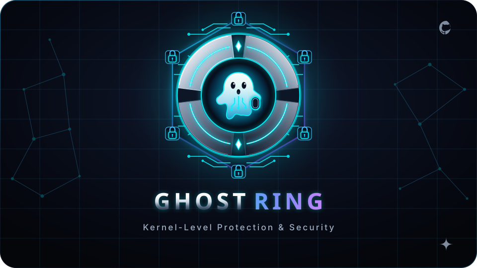

<p align="center">
  
</p>

# GhostRing

**Real-time Ring 0 eBPF security telemetry and observability engine in pure Rust.**

GhostRing instruments the Linux kernel at Ring 0 via eBPF using the [Aya framework](https://aya-rs.dev/). By capturing security-critical system execution paths directly in kernel space, it provides tamper-resistant, zero-trust system auditing that remains invisible to rootkits and user-space evasion.

---

## Documentation

All architectural specifications, low-level mechanics, and operational guides are documented in the **[`docs/`](docs/index.html)** suite:

* **[Architecture & Workspace](docs/architecture-overview.html)** — 3-crate workspace partitioning (`ghostring-common`, `ghostring-ebpf`, `ghostring`), crate boundaries, and [Build System](docs/build-system-workspace.html).
* **[Telemetry Pipeline](docs/event-transport.html)** — Ring 0 tracepoint interception, `PerfEventArray` mechanics, and [Perf Buffer Internals](docs/perf-buffer-internals.html).
* **[Kernel Space & eBPF Engineering](docs/ebpf-internals.html)** — Bytecode ISA, [Aya Framework](docs/aya-framework.html), [BTF & CO-RE](docs/btf-co-re-deep-dive.html), and [C-compatible ABI Structs](docs/ghostring-common-structs.html).
* **[User Daemon](docs/ghostring-user-daemon.html)** — Async Tokio daemon architecture, buffer poller loop, CLI flags, and logging.
* **[Prerequisites & Environment](docs/development-environment.html)** — System requirements (Linux 5.8+, BTF) and isolated in-repo toolchain (`.build-env/`).
* **[Testing Strategy](docs/testing-strategy.html)** — 4-tier testing pyramid, layout validation, and benchmarks.
* **[Troubleshooting Guide](docs/troubleshooting-guide.html)** — Diagnostic workflows for build, verifier, and runtime errors.
* **[Security & License Compliance](docs/license-compliance-deep.html)** — [Security Model](docs/security-model-deep-dive.html), [Security Requirements](docs/security-requirements.html), and GPLv3 kernel verifier rules.
* **[Technical Roadmap](docs/roadmap-features-deep.html)** — Blueprints for path reads, socket observability (`tcp_connect`), and FIM (`sys_enter_openat`).

*Full index and recommended reading paths: **[docs/index.html](docs/index.html)***

---

## Quickstart

### 1. Bootstrap Environment

GhostRing uses an isolated in-repository build environment (`.build-env/`) so host toolchains remain untouched:

```bash
git clone https://github.com/ankur3-101106/GhostRing.git
cd GhostRing
./scripts/setup-env.sh
source .build-env/activate
```

### 2. Build & Run

```bash
# Compile kernel eBPF bytecode
cargo build --release -p ghostring-ebpf

# Run the user-space daemon (requires root / CAP_BPF)
sudo -E cargo run --release -p ghostring
```

---

## License & Compliance

Distributed under the **[GNU General Public License v3.0](LICENSE)** (GPLv3). GPL compatibility is strictly required by the Linux kernel verifier to access advanced BPF helper functions. Details in [License Compliance Deep Dive](docs/license-compliance-deep.html).

---

## Community

* [Contributing Guide](CONTRIBUTING.md) • [Code of Conduct](CODE_OF_CONDUCT.md) • [Security Policy](SECURITY.md) • [Commit Standards](COMMIT.md)
